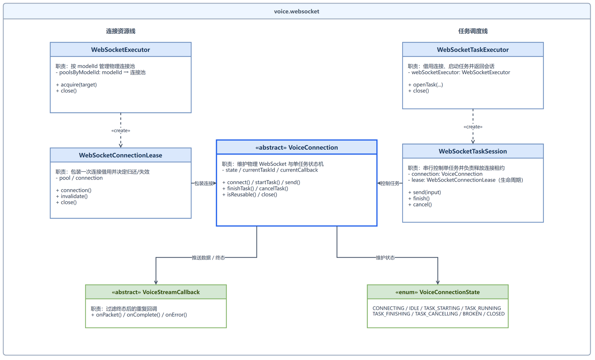
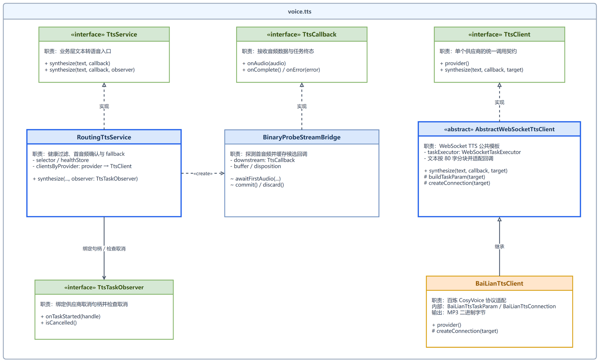
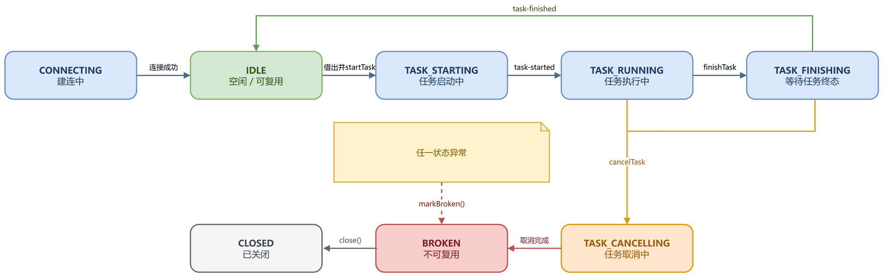
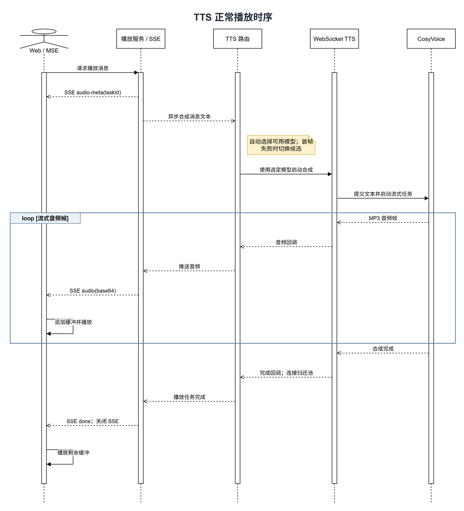
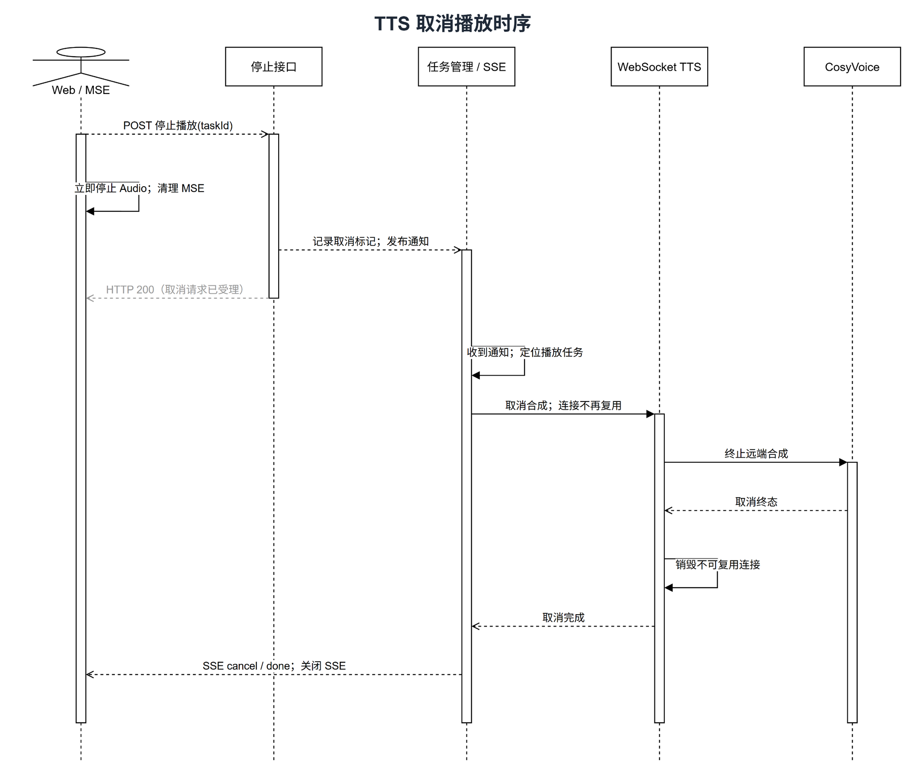

# feat(voice): 新增基于 WebSocket 连接池的流式 TTS 消息播放

演示视频：[ragent-语音播放功能演示](https://www.bilibili.com/video/BV18Du36gEzc?vd_source=1258e036eb41f172b62821a57f402efa)

Closes #108

## 背景

当前聊天消息仅支持文本阅读。为了让用户直接收听已生成的 assistant 消息，本次新增端到端的流式 TTS 播放能力：后端从消息记录读取文本，通过池化 WebSocket 调用百炼 CosyVoice，并使用 SSE 将 MP3 音频帧持续推送给浏览器；前端基于 MediaSource 边接收、边缓冲、边播放。

同时抽象了可复用的 Voice WebSocket 连接与任务生命周期，避免每次播放都重新建立物理连接，并收敛成便于扩展其他基于 WebSocket 的流式语音能力。

## 设计参考

- [阿里云百炼实时语音合成使用指南](https://help.aliyun.com/zh/model-studio/realtime-tts-user-guide#ug-hc-h3)
- [火山引擎流式语音合成文档](https://docs.volcengine.com/docs/6561/1329505?lang=zh)

## 主要变更

- 新增消息语音播放与停止接口，通过 SSE 向浏览器持续推送 MP3 音频帧。
- 前端使用 MediaSource 边接收边播放，并支持再次点击、切换或删除会话时停止播放。
- 新增 TTS 模型路由和首音频探测，候选失败时自动取消并尝试后续模型。
- 接入百炼 CosyVoice WebSocket，完成文本分片发送、音频回调和任务终态处理。
- 新增按模型隔离的 WebSocket 连接池；正常完成后复用连接，取消或异常时废弃连接。
- 将任务等待调整为首帧超时与音频包空闲超时，并补充相关配置、线程池和测试。

## 接口与事件约定

- `GET /rag/v3/voice/play?messageId=...`：建立语音播放 SSE。
- `POST /rag/v3/voice/stop?taskId=...`：停止播放任务。
- 正常播放的 SSE 事件顺序为 `audio-meta` → `audio` × N → `done`；`audio-meta` 携带任务 ID，`audio` 携带 Base64 MP3 音频帧。

## 完整流程

1. 用户点击 assistant 消息的语音按钮。
2. 前端请求 `/rag/v3/voice/play`，后端校验并读取当前用户的消息文本。
3. 后端先发送 `audio-meta(taskId)`，随后在线程池中异步调用 `TtsService`。
4. TTS 路由选择健康候选，并从对应 `modelId` 的连接池借用 WebSocket。
5. 客户端发送 `run-task`、分块 `continue-task` 和 `finish-task`。
6. 百炼持续返回 MP3 二进制帧；首帧探测成功后，音频通过回调和 SSE 透传给前端。
7. 前端把音频帧依次追加到 MSE 缓冲区，首帧入缓冲后开始播放。
8. 收到 `task-finished` 后发送 `done`、关闭 SSE，并将正常连接归还池中。
9. 用户主动停止时取消任务并清理本地播放资源，当前 WebSocket 连接不再复用。

## 设计图

### WebSocket 包

展示连接资源生命周期与任务生命周期如何汇聚到物理连接核心。

### TTS 包

展示 TTS 业务入口、候选路由、首音频探测桥接、任务观察者及供应商 WebSocket 客户端之间的职责与继承关系。

### WebSocket 单连接生命周期

展示单条物理连接从建立、执行任务、正常复用，到取消、异常及关闭的状态变化。

### TTS 正常播放时序

展示播放请求、模型选择、流式音频通过 SSE 进入 MSE 播放，以及正常完成后的连接复用。

### TTS 停止 / 取消时序

展示用户发起停止后立即清理本地播放器，后端异步取消远端合成、销毁不可复用连接，并在取消完成后关闭 SSE。

## 验证结果

- [x] `BaiLianTtsClientTest`：8 个测试通过。
- [x] `RoutingTtsServiceTest`：4 个测试通过。
- [x] `ModelSelectorTest`：10 个测试通过，包含 TTS 候选和统一超时映射。
- [x] 前端 `npm run build` 通过。
- [x] `git diff --check` 通过。
- [x] 新增配置项已提供默认值和示例。
- [x] 已使用真实百炼环境完成端到端人工验证（见演示视频）。
