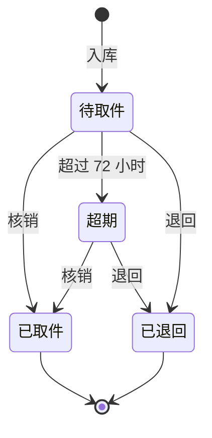

# 校园快递收发系统 · 后端

本文件是软件工程课程设计的后端说明。
课程设计题目取自课程 PPT 选题表第 4 项「校园快递收发系统」。

## 1. 文档规则

本文件按 ASD-STE100 简化技术英语的写作规则编写，规则如下：

1. 一句只表达一个意思。句子不超过 25 个汉字。
2. 使用主动语态。不使用被动句。
3. 操作步骤使用祈使句。一步只做一个动作。
4. 同一事物只用一个名称。名称见第 2 节术语表。
5. 不使用比喻、口语和省略句。
6. 一个段落只讲一个主题。

接口文档见 [[api]]。接口文档使用同一套规则。

## 2. 术语表

| 术语 | 含义 |
| --- | --- |
| 包裹 | 一件快递。系统的最小业务对象。 |
| 运单号 | 快递公司给包裹的编号。 |
| 驿站 | 校内的快递代收点。 |
| 入库 | 工作人员把包裹登记到系统。 |
| 取件码 | 系统给包裹生成的 6 位数字。学生凭此码取件。 |
| 核销 | 工作人员确认包裹已被取走。核销后包裹状态变为已取件。 |
| 退回 | 包裹未取走。工作人员把包裹退回快递公司。 |
| 超期 | 包裹入库超过 72 小时仍未取走。 |
| 学生 | 角色 `USER`。取件的一方。 |
| 工作人员 | 角色 `STAFF`。驿站的经办人。 |
| 管理员 | 角色 `ADMIN`。系统的维护人。 |

## 3. 系统概述

系统管理校园快递的入库、取件和退回。
系统有三个角色：学生、工作人员、管理员。
学生查看自己的包裹和取件码。
工作人员登记包裹并核销取件。
管理员维护用户、驿站和公告，并查看统计。

## 4. 技术栈

| 层次 | 选型 | 版本 |
| --- | --- | --- |
| 语言 | Go | 1.22 以上 |
| Web 框架 | Gin | v1.10 |
| ORM | GORM | v1.25 |
| 数据库 | MySQL | 8.0 |
| 缓存 | Redis（存登录会话） | 7.x |
| 登录态 | Cookie + Redis 会话（go-redis） | v9.7 |
| 密码加密 | bcrypt（golang.org/x/crypto） | 最新 |
| 参数校验 | validator（Gin 内置） | v10 |
| 跨域 | gin-contrib/cors | v1.7 |

## 5. 目录结构

### 5.1 项目根目录

项目根目录是「校园快递收发系统」。下文路径都相对这个目录。

```text
校园快递收发系统/
├── README.md                # 本文件
├── api.md                   # 接口文档
├── 测试用例.md               # 测试用例与 BUG 清单
├── 交付物清单.md             # 课程设计要求核对
├── 设计图/                   # 5 张设计图、图集与生成脚本
│   ├── gen_diagrams.py      # 重新生成 PNG
│   ├── make_docx.py         # 合成 设计图集.docx
│   ├── 1-业务流程图.png
│   ├── 2-模块结构图.png
│   ├── 3-程序流程图-包裹入库.png
│   ├── 4-程序流程图-取件核销.png
│   ├── 5-E-R图.png
│   └── 设计图集.docx
└── backend/                 # 后端源码，见 5.2
```

要重新生成设计图，在项目根目录执行：

```powershell
python 设计图/gen_diagrams.py
python 设计图/make_docx.py
```

两个脚本按自身位置定位目录，与本机路径无关。
依赖 Pillow 与 python-docx。中文字体会自动查找，找不到时提示。

### 5.2 后端目录

```text
backend/
├── main.go                      # 启动入口。启动时运行超期检查。
├── go.mod / go.sum
├── .gitignore
├── db/
│   └── campus_express.sql       # 建库、建表、初始数据。
├── test/
│   └── api_test.go              # 接口自动化测试，60 条用例。
└── internal/
    ├── db/db.go                 # 连接数据库。
    ├── cache/redis.go           # 连接 Redis。
    ├── model/model.go           # 实体定义、状态常量、状态判断。
    ├── session/session.go       # 会话读写：创建、校验、续期、销毁。
    ├── router/router.go         # 注册路由、开启跨域。
    └── handler/
        ├── common.go            # 统一响应、会话中间件、参数校验、工具函数。
        ├── auth.go              # 注册、登录、个人中心。
        ├── user.go              # 用户管理。
        ├── station.go           # 驿站管理。
        ├── parcel.go            # 包裹入库、查询、核销、退回。
        ├── notice.go            # 公告管理。
        └── stats.go             # 数据统计。
```

## 6. 运行步骤

### 6.1 准备数据库

1. 启动 MySQL。本机使用 Docker 容器 `helloworld-mysql`。
2. 导入脚本。

```powershell
docker exec -i helloworld-mysql mysql -uroot -proot --default-character-set=utf8mb4 < db/campus_express.sql
```

脚本重建 `campus_express` 库。
脚本写入 2 个驿站、4 个账号、4 条包裹、1 条取件记录、2 条公告。

### 6.2 准备 Redis

Redis 用来存登录会话。
本机 6379 端口已被占用时，用下面的命令启动独立容器。容器端口映射到 6380。

```powershell
docker run -d --name campus-redis -p 127.0.0.1:6380:6379 redis:7-alpine
```

容器启动后，启动后端时把地址传给程序：

```powershell
$env:REDIS_ADDR = "127.0.0.1:6380"
```

如果 Redis 在 6379 且没有密码，可以跳过这一步。程序默认连接 `127.0.0.1:6379`。

### 6.3 启动后端

1. 进入 `backend` 目录。
2. 运行 `go run .`。

```powershell
cd backend
go run .
```

服务监听 `http://localhost:8080`。
默认连接 `root/root@127.0.0.1:3306/campus_express`。

### 6.4 验证启动

运行下面的命令。返回 `pong` 表示启动成功。

```powershell
curl http://localhost:8080/api/ping
```

### 6.5 登录并调用接口

1. 调用登录接口。服务端返回 `session_id` Cookie。
2. 用同一个 Cookie 文件调用其他接口。

```powershell
curl -X POST http://localhost:8080/api/auth/login -c cookie.txt -H "Content-Type: application/json" -d "{\"phone\":\"13800000001\",\"password\":\"123456\"}"
curl http://localhost:8080/api/stats/overview -b cookie.txt
```

浏览器前端不需要手动处理 Cookie。
前端请求必须带 `credentials: 'include'`。写法见 [[api]] 第 1 节。

## 7. 账号

初始密码都是 `123456`。密码用 bcrypt 存储。

| 角色 | 手机号 | 说明 |
| --- | --- | --- |
| 管理员 | `13800000000` | 系统管理员。 |
| 工作人员 | `13800000001` | 东区菜鸟驿站。 |
| 学生 | `13800000002` | 张三。 |
| 学生 | `13800000003` | 李四。 |

## 8. 环境变量

| 变量 | 默认值 | 说明 |
| --- | --- | --- |
| `MYSQL_HOST` | `127.0.0.1` | 数据库地址。 |
| `MYSQL_PORT` | `3306` | 数据库端口。 |
| `MYSQL_USER` | `root` | 数据库账号。 |
| `MYSQL_PASSWORD` | `root` | 数据库密码。 |
| `MYSQL_DB` | `campus_express` | 数据库名。 |
| `REDIS_ADDR` | `127.0.0.1:6379` | Redis 地址。 |
| `REDIS_PASSWORD` | 空 | Redis 密码。没有密码时留空。 |
| `REDIS_DB` | `0` | Redis 库号。 |
| `PORT` | `8080` | 服务端口。 |

## 9. 功能清单

| 模块 | 功能 | 角色 |
| --- | --- | --- |
| 注册登录 | 学生注册。手机号加密码登录。 | 公开 |
| 登录态 | 登录成功下发 `session_id` Cookie。会话存 Redis。有效期 2 小时。每次请求续期。 | 公开 |
| 个人中心 | 查看资料、修改资料、修改密码。 | 全部 |
| 用户管理 | 查询、新增、修改、启停、重置密码、删除。 | 管理员 |
| 驿站管理 | 查询、新增、修改、删除。 | 管理员 |
| 包裹入库 | 登记运单号、收件人、货架号。系统生成取件码。 | 工作人员 |
| 包裹查询 | 按状态、驿站、快递公司、手机号、关键词、日期组合查询。 | 工作人员 |
| 我的包裹 | 学生按手机号查看自己的包裹。 | 全部 |
| 取件核销 | 按包裹编号或取件码核销。记录本人取件或代取。 | 工作人员 |
| 包裹退回 | 未取走的包裹退回。 | 工作人员 |
| 超期处理 | 每 10 分钟检查一次。入库超过 72 小时的包裹标记为超期。 | 系统 |
| 取件记录 | 按手机号、关键词、日期查询。 | 工作人员 |
| 公告 | 公告的增删改查。 | 管理员 |
| 数据统计 | 状态概览、快递公司分布、驿站包裹量、近 N 天趋势。 | 工作人员 |

## 10. 数据库设计

系统共 5 张表。

| 表 | 作用 | 主要字段 |
| --- | --- | --- |
| `sys_user` | 用户 | `phone` 唯一。`role` 区分角色。`station_id` 指向驿站。 |
| `station` | 驿站 | 名称、地址、负责人、营业时间、状态。 |
| `parcel` | 包裹 | `tracking_no` 运单号。`pickup_code` 取件码。`status` 状态。 |
| `pickup_record` | 取件记录 | `parcel_id` 指向包裹。记录取件方式和操作人。 |
| `notice` | 公告 | 标题、内容、发布人。 |

索引如下：

| 表 | 索引 | 用途 |
| --- | --- | --- |
| `sys_user` | `uk_user_phone` | 手机号唯一。 |
| `parcel` | `idx_parcel_phone` | 按手机号查包裹。 |
| `parcel` | `idx_parcel_code` | 按取件码查包裹。 |
| `parcel` | `idx_parcel_status` | 按状态筛选。 |
| `pickup_record` | `idx_record_parcel` | 按包裹查取件记录。 |

完整的建表语句见 `db/campus_express.sql`。字段带中文注释。

## 11. 状态流转

### 11.1 包裹状态

| 值 | 名称 | 含义 |
| --- | --- | --- |
| `0` | 待取件 | 包裹已入库，等待取件。 |
| `1` | 已取件 | 已核销。终态。 |
| `2` | 超期 | 入库超过 72 小时。仍可取件或退回。 |
| `3` | 已退回 | 已退回快递公司。终态。 |

### 11.2 允许的状态变化

| 当前状态 | 操作 | 目标状态 | 条件 |
| --- | --- | --- | --- |
| 无 | 入库 | `0` 待取件 | 驿站存在且营业。 |
| `0` | 核销 | `1` 已取件 | — |
| `2` | 核销 | `1` 已取件 | — |
| `0` | 退回 | `3` 已退回 | — |
| `2` | 退回 | `3` 已退回 | — |
| `0` | 定时任务 | `2` 超期 | 入库超过 72 小时。 |
| `1` | 任何操作 | 不允许 | 返回 `400`。 |
| `3` | 任何操作 | 不允许 | 返回 `400`。 |

### 11.3 状态图



### 11.4 用户状态

| 值 | 名称 | 含义 |
| --- | --- | --- |
| `1` | 正常 | 可以登录。 |
| `0` | 禁用 | 不能登录。已登录的请求返回 `403`。 |

## 12. 参数校验规则

校验规则写在请求结构体的 `binding` 标签上。
框架自动校验。错误信息由 `handler/common.go` 翻译成中文。

| 字段 | 规则 | 错误提示示例 |
| --- | --- | --- |
| 手机号 | 必填。11 位。纯数字。 | `手机号长度必须为 11 位` |
| 密码 | 必填。6 到 20 位。 | `密码不能小于 6` |
| 姓名 | 最多 20 字。 | `姓名不能超过 20` |
| 角色 | 只能是 `USER`、`STAFF`、`ADMIN`。 | `角色只能是 USER / STAFF / ADMIN` |
| 用户状态 | 只能是 `0` 或 `1`。 | `状态只能是 0（禁用）或 1（正常）` |
| 运单号 | 必填。最多 50 字。 | `运单号不能为空` |
| 收件人手机号 | 必填。11 位。纯数字。 | `收件人手机号长度必须为 11 位` |
| 驿站编号 | 入库时必填。必须存在且营业。 | `该驿站已停用，不能入库` |
| 取件码 | 6 位数字。 | `取件码必须是 6 位数字` |
| 取件方式 | 只能是 `1`（本人）或 `2`（代取）。 | `取件方式只能是 1 / 2` |
| 包裹状态筛选 | 只能是 `0`、`1`、`2`、`3`。 | `状态只能是 0（待取件）/ 1（已取件）/ 2（超期）/ 3（已退回）` |
| 营业时间 | 格式 `HH:mm`。 | `营业时间格式必须是 HH:mm` |
| 公告标题 | 必填。最多 100 字。 | `标题不能为空` |
| 分页 | `page` 默认 1。`size` 默认 10，最大 100。 | — |

## 13. 接口文档

全部 39 个接口的说明、参数、校验规则和示例见 [[api]]。

## 14. 课程设计交付物对应

| 交付物 | 本文档或代码的位置 |
| --- | --- |
| 数据分析表 | 第 10 节 数据库设计。 |
| 功能分析表 | 第 9 节 功能清单。 |
| 业务流程分析图 | 第 11 节 状态流转。 |
| 总体结构设计、模块结构图 | 第 5 节 目录结构。 |
| 数据库设计、表结构 | 第 10 节、`db/campus_express.sql`。 |
| 详细设计、程序流程图 | `设计图/` 图 3 与图 4。代码见 `internal/handler/parcel.go`。 |
| 系统实现、源码 | `backend/` 全部文件。 |
| 系统测试、测试用例 | [[测试用例]] 与 `backend/test/api_test.go`。 |

## 15. 测试记录

测试脚本用 HTTP 调用真实接口。测试数据来自初始化脚本。

### 15.1 功能用例

| 编号 | 用例 | 预期 | 结果 |
| --- | --- | --- | --- |
| T01 | 管理员登录。 | 下发 `session_id` Cookie。 | 通过 |
| T02 | 密码错误。 | `400 密码错误`。 | 通过 |
| T03 | 不带 Cookie 查用户列表。 | `401 未登录或登录已失效`。 | 通过 |
| T04 | 学生查用户列表。 | `403 仅管理员可操作`。 | 通过 |
| T05 | 重复注册。 | `400 该手机号已注册`。 | 通过 |
| T06 | 工作人员入库。 | 返回 6 位取件码，状态为 0。 | 通过 |
| T07 | 按状态和关键词查包裹。 | 返回匹配记录。 | 通过 |
| T08 | 按取件码核销。 | 状态变 1，生成取件记录。 | 通过 |
| T09 | 退回待取件包裹。 | 状态变 3。 | 通过 |
| T10 | 用户增改启停删全流程。 | 全部成功。删除后查询 `404`。 | 通过 |
| T11 | 公告增改删。 | 全部成功。学生发布返回 `403`。 | 通过 |
| T12 | 统计四个接口。 | 数值与库内数据一致。 | 通过 |

### 15.2 校验与状态用例

| 编号 | 用例 | 预期 | 结果 |
| --- | --- | --- | --- |
| V01 | 注册时手机号 3 位。 | `400 手机号长度必须为 11 位`。 | 通过 |
| V02 | 注册时密码 3 位。 | `400 密码不能小于 6`。 | 通过 |
| V03 | 注册时手机号含字母。 | `400 手机号只能是数字`。 | 通过 |
| V04 | 登录时不传密码。 | `400 密码不能为空`。 | 通过 |
| V05 | 新增驿站不传名称。 | `400 驿站名称不能为空`。 | 通过 |
| V06 | 新增驿站营业时间写 `8点`。 | `400 营业时间格式必须是 HH:mm`。 | 通过 |
| V07 | 入库不传驿站。 | `400 驿站不能为空`。 | 通过 |
| V08 | 入库传不存在的驿站。 | `400 驿站不存在`。 | 通过 |
| V09 | 向停用驿站入库。 | `400 该驿站已停用，不能入库`。 | 通过 |
| V10 | 入库手机号 3 位。 | `400 收件人手机号长度必须为 11 位`。 | 通过 |
| V11 | 新增工作人员不指定驿站。 | `400 工作人员必须指定所属驿站`。 | 通过 |
| V12 | 新增用户角色写 `SUPER`。 | `400 角色只能是 USER / STAFF / ADMIN`。 | 通过 |
| V13 | 用户状态传 `5`。 | `400 状态只能是 0（禁用）或 1（正常）`。 | 通过 |
| V14 | 用户状态不传。 | `400 状态只能是 0（禁用）或 1（正常）`。 | 通过 |
| V15 | 包裹列表状态传 `9`。 | `400 状态只能是 0（待取件）…`。 | 通过 |
| V16 | 取件码传 3 位。 | `400 取件码必须是 6 位数字`。 | 通过 |
| V17 | 取件方式传 `3`。 | `400 取件方式只能是 1 / 2`。 | 通过 |
| V18 | 修改已取件包裹。 | `400 已取件或已退回的包裹不能修改`。 | 通过 |
| V19 | 退回已取件包裹。 | `400 该包裹已取件，不能退回`。 | 通过 |
| V20 | 重复核销同一包裹。 | `400 该包裹已取件，不能重复核销`。 | 通过 |
| V21 | 公告标题为空。 | `400 标题不能为空`。 | 通过 |

新增用例共 27 条断言，全部通过。

### 15.3 会话用例

| 编号 | 用例 | 预期 | 结果 |
| --- | --- | --- | --- |
| S01 | 管理员登录。 | 下发 `session_id` Cookie。HttpOnly。有效期 7200 秒。 | 通过 |
| S02 | 携带 Cookie 访问受保护接口。 | 返回数据。 | 通过 |
| S03 | 不带 Cookie。 | `401 未登录或登录已失效`。 | 通过 |
| S04 | 伪造 Cookie。 | `401 未登录或登录已失效`。 | 通过 |
| S05 | 退出登录后再用旧 Cookie。 | `401 未登录或登录已失效`。 | 通过 |
| S06 | 学生 Cookie 访问用户管理。 | `403 仅管理员可操作`。 | 通过 |
| S07 | 账号被禁用后用旧 Cookie。 | `403 账号已被禁用`。 | 通过 |
| S08 | 修改密码后用旧 Cookie。 | `401 未登录或登录已失效`。 | 通过 |

会话用例共 25 条断言，全部通过。

### 15.4 自动化测试

全部用例写成 Go 测试，编号见 [[测试用例]]。
运行方式：

```powershell
cd backend
$env:REDIS_ADDR = "127.0.0.1:6380"
go test ./test/ -v
```

测试会自己创建数据，并在结束时清理。运行前先导入 `db/campus_express.sql`。

```text
--- PASS: TestAuth (0.80s)
--- PASS: TestParcelInbound (1.12s)
--- PASS: TestParcelQuery (0.55s)
--- PASS: TestPickup (1.30s)
--- PASS: TestStation (0.21s)
--- PASS: TestUser (0.57s)
--- PASS: TestNoticeAndStats (0.33s)
ok   campus-express/test  6.4s
```

共 62 条用例，全部通过。

## 16. 说明与限制

1. 鉴权只做登录校验和角色判断。系统不做细粒度权限控制。
2. 密码用 bcrypt 存储。接口不返回密码字段。
3. 会话有效期 2 小时。每次请求自动续期。
4. 退出登录时服务端删除 Redis 会话，并清除 Cookie。
5. 修改密码后当前会话立即失效，用户需要重新登录。
6. 取件通知用服务端日志模拟。系统不接短信网关。
7. 测试脚本用 Python 编写，不放进仓库。
